# Dub Booth

**Dub each clip while the original plays in your ears.** Dub Booth is a dubbing studio that runs in the browser, built for a phone first. Load the original clips, record a dub for each one, build the best version from all your takes, and export files that drop straight back into your project.

It's one web page. Nothing is uploaded: your originals, takes and dubs stay on your device.

**Open it:** [braveh.github.io/Dub-Booth/dub-booth.html](https://braveh.github.io/Dub-Booth/dub-booth.html). On an iPhone, open it in Safari and choose **Share → Add to Home Screen** to use it like an app. It works offline after the first visit.

<p align="center">
  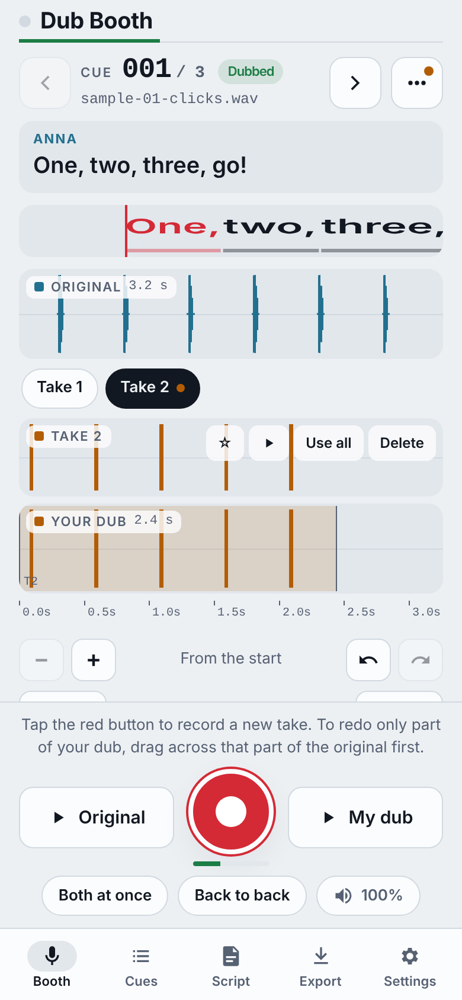
  &nbsp;
  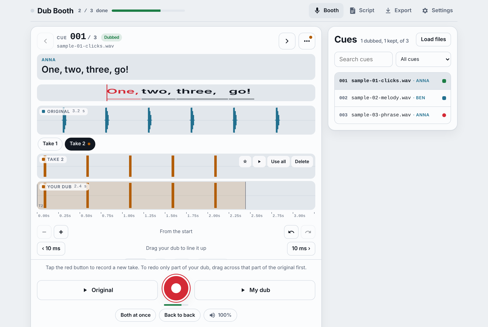
</p>

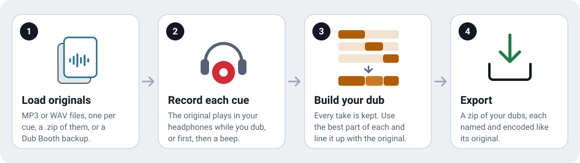

## Contents

- [Getting started](#getting-started)
- [The five screens](#the-five-screens)
- [Recording](#recording)
- [Takes and your dub](#takes-and-your-dub)
- [Marking cues](#marking-cues)
- [Script, characters and the rhythmo band](#script-characters-and-the-rhythmo-band)
- [Transcribing the originals](#transcribing-the-originals)
- [Export](#export)
- [Backups, storage and working offline](#backups-storage-and-working-offline)
- [Remote control and keyboard](#remote-control-and-keyboard)
- [Troubleshooting](#troubleshooting)
- [For developers](#for-developers)

## Getting started

1. **Load your originals.** Tap **Choose files** and pick the clips, one file per cue (MP3, M4A, WAV or AIFF), or a single `.zip` of them. A Dub Booth backup opens the same way. **Try with 3 sample clips** loads a small demo.
2. **Put on wired headphones** and tap the red button. The first tap turns the microphone on; the next starts a take.
3. **Record each cue.** The original plays in your ears while you dub. Tap the button again to stop. Recording runs until you stop, so long lines are fine.
4. **Export.** On the Export screen, build a zip of every dub. Each file has its original's name and, where the original is an MP3, its format too.

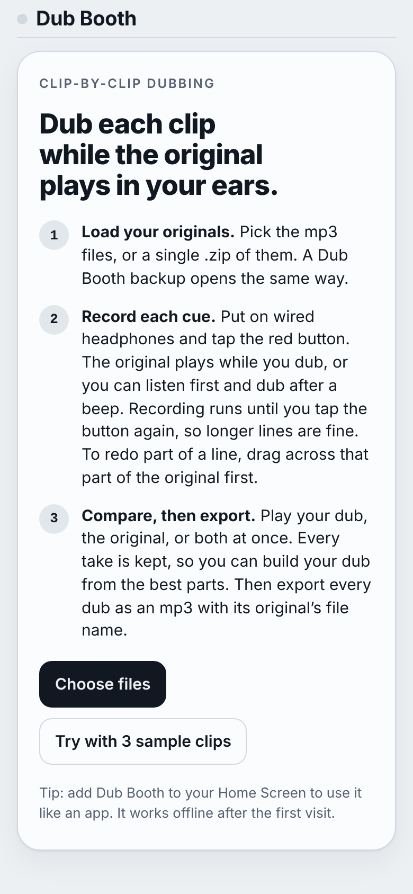

## The five screens

A tab bar switches between the screens. On a phone it sits at the bottom; on a computer it's in the top bar, and the cue list stays beside the booth. The app remembers which screen you were on.

| Booth | Cues | Script | Export | Settings |
|---|---|---|---|---|
|  | 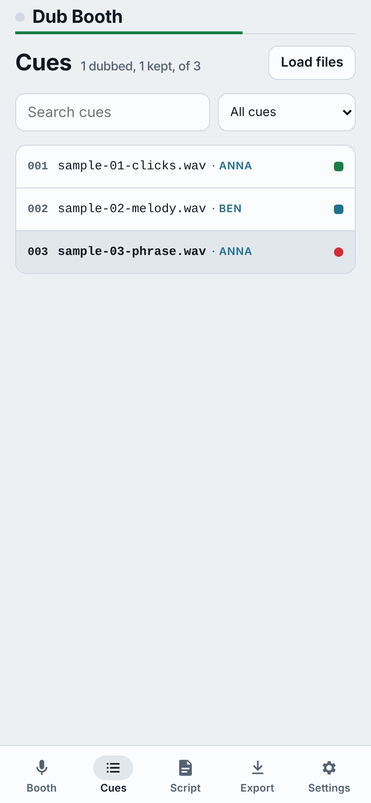 | 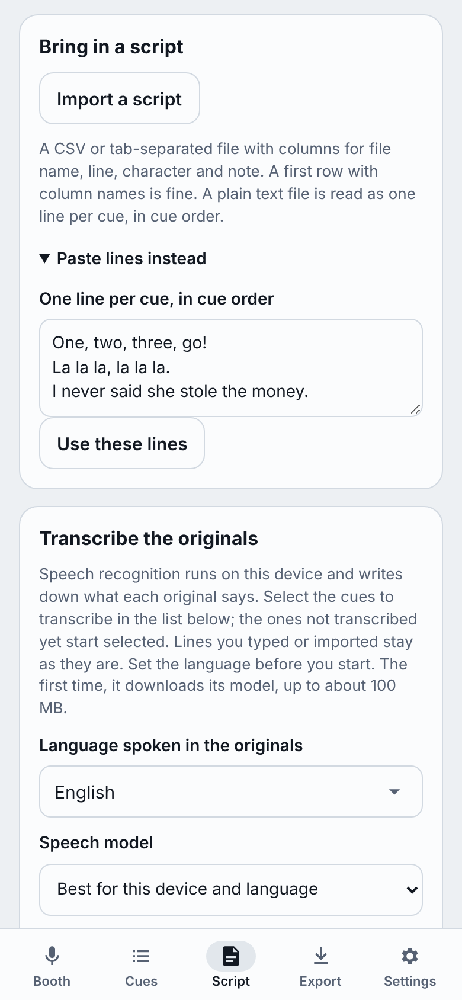 | 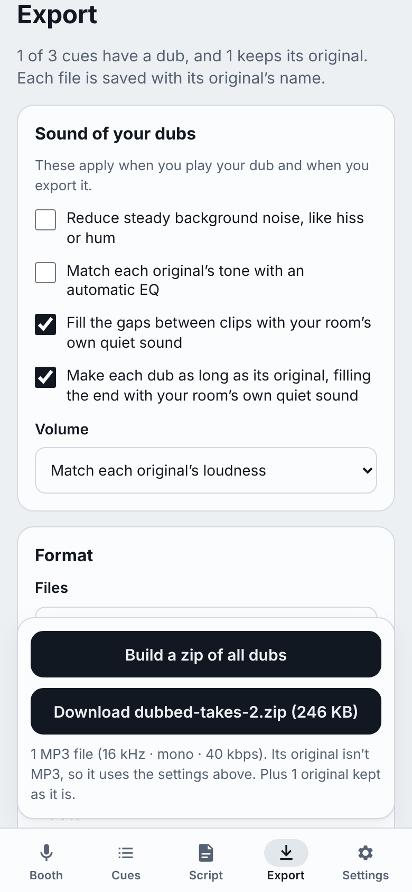 | 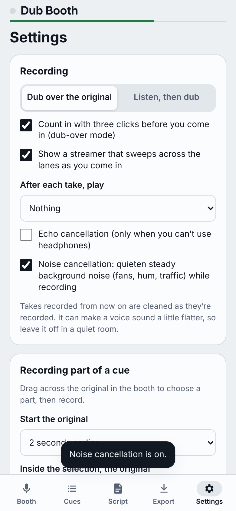 |
| Record, listen, and build your dub | Every cue, its state, search and filters | Lines, characters, transcription | The sound of your dubs, formats and names | Recording, sync, remote keys, storage |

## Recording

**Two ways to record** (Settings → Recording):

- **Dub over the original:** the original plays in your headphones while you record. With **Count in**, three clicks lead you in. A **streamer** (a line that sweeps across the lanes) can show you when to come in.
- **Listen, then dub:** the original plays first, then a beep, then you record.

**Redo just part of a cue (punch-in).** Drag across the original to select a stretch, then record. The original starts a little earlier (the *pre-roll*, 0 to 5 seconds) so you can come in on time. The new take only replaces the selected part. You can have the original keep playing inside the selection, play quieter, or go silent, and have recording stop at the end of the selection.

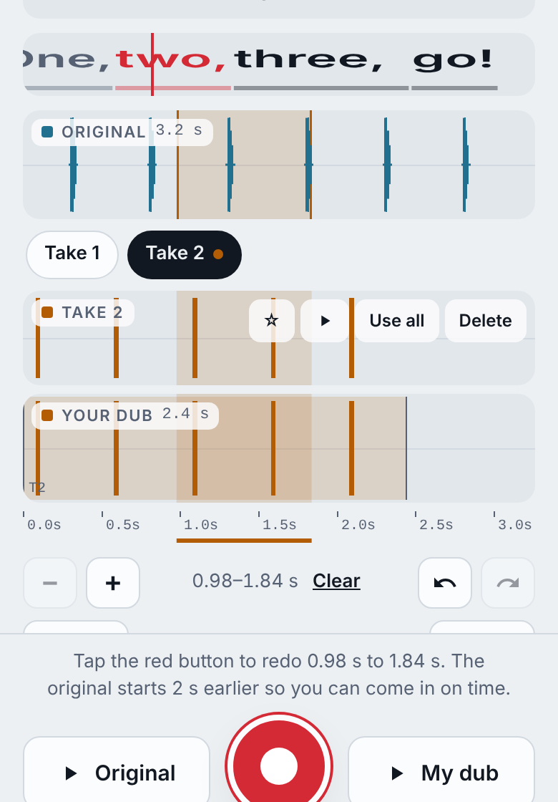

**Loop the selection** to record pass after pass, each one a new take, until you tap stop.

**After each take** the app can play your dub, both together, or one after the other.

**Playback volume.** The speaker button beside *Both at once* and *Back to back* opens a slider from 0 to 200%. It sets how loud everything you hear plays (originals, dubs and count-in clicks); it doesn't change what's recorded or exported.

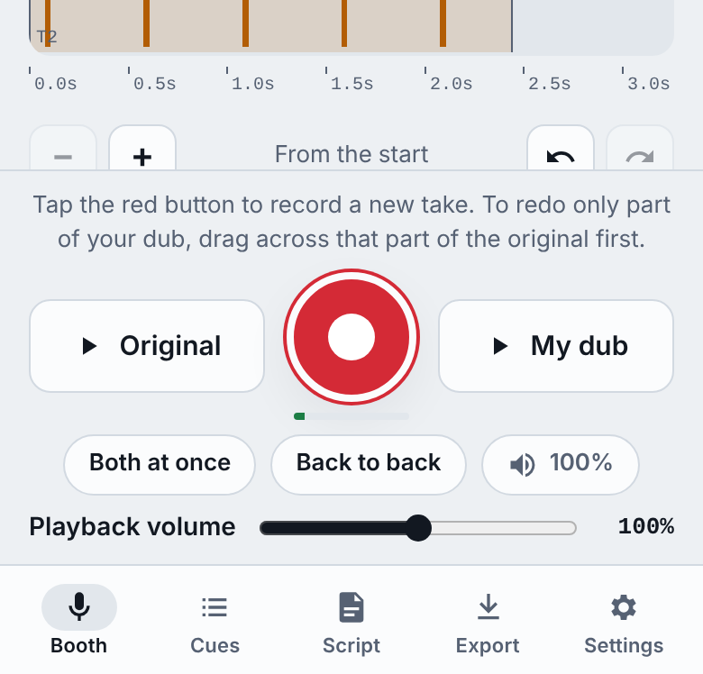

**Noise cancellation** (Settings → Recording) quietens steady background noise like fans, hum and traffic while you record. It can make a voice sound a little flatter, so leave it off in a quiet room. Safari on iPhone has no noise setting of its own, so there the phone's voice processing is used, which also turns on echo cancellation. To make it stronger on an iPhone, open Control Center while recording, tap **Mic Mode** and choose **Voice Isolation**.

**Echo cancellation** is only for when you can't use headphones: it stops the original leaking from the speaker into your take, but changes the sound of your voice.

**Sync calibration** (Settings) measures how long this device takes between playing and recording, so new takes land in sync. Use **Measure this device** once with headphones on.

## Takes and your dub

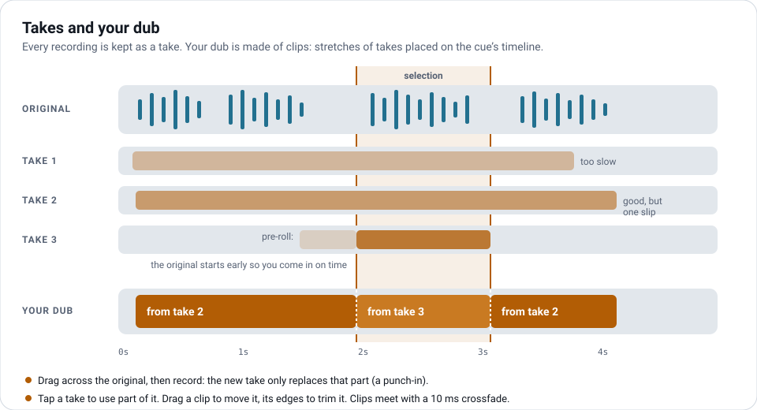

Every recording is kept as a **take**. Your **dub** is what plays when you tap **My dub** and what export writes. It's built from **clips**: stretches of takes placed on the cue's timeline.

- **The take lane** appears once there's more than one take. Pick a take with its chip, then drag across part of it to use that part in your dub. **Use all** puts the whole take in; ★ stars it; **Delete** removes it.
- **Move and trim:** drag a clip in *Your dub* to move it; drag its edges to trim. The arrow buttons nudge it by 10 ms. Clips meet with a short 10 ms crossfade.
- **Line up** moves a clip (or each phrase on its own) to where its loudness pattern best matches the original. **Fit** stretches or squeezes a clip to fill the selected stretch of the original (between 70% and 140% of its length) without changing its pitch.
- **Split** cuts a clip at the start point; **Delete clip** removes it from the dub (the take stays).
- **Undo and redo** cover every edit to a cue's dub.
- **Compare:** play the **Original**, **My dub**, **Both at once**, or **Back to back**. Zoom with the − and + buttons, a pinch, or Ctrl and the scroll wheel.

## Marking cues

The **⋯** button on the cue bar opens the cue's details:

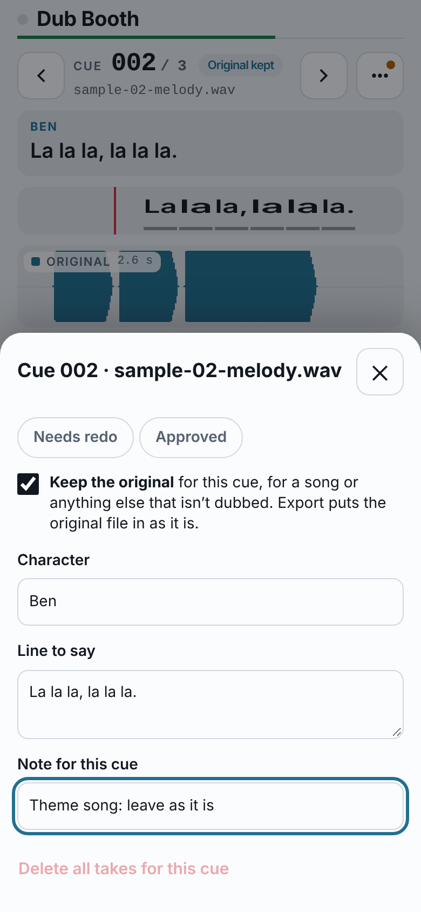

- **Needs redo** and **Approved** mark where a cue stands. The cue list shows them and can filter by them.
- **Keep the original** is for cues that aren't dubbed, such as songs. The cue shows *Original kept*, counts as done, is left out of transcription, and export puts the original file in exactly as it is.
- **Character** and **Line to say** (also editable on the Script screen).
- **Notes** for the cue, and for the selected take.
- **Delete all takes for this cue** (with undo).

The **Cues** screen lists every cue with its state (dubbed, approved, needs redo, original kept), and can search names, lines, characters and notes.


## Script, characters and the rhythmo band

On the **Script** screen:

- **Import a script:** a CSV or tab-separated file with columns for file name, line, character and note (a header row is fine). A plain text file is read as one line per cue, in cue order.
- **Paste lines:** one line per cue, in order.
- **Every line:** edit any cue's line and character in one list; changes save as you type.

Lines and characters show in the booth above the lanes. Character names also give the cue list a filter and can name export folders.

**The rhythmo band** scrolls the line's words past a red mark as they should be spoken, as on a dubbing stage.

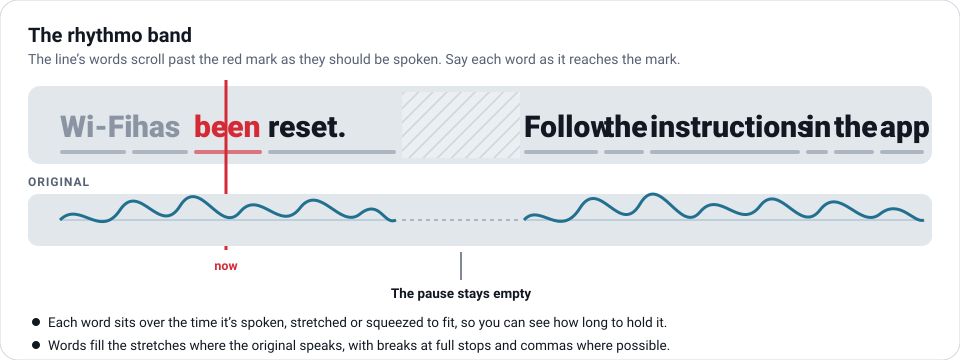

- Each word sits over the time it's spoken, stretched or squeezed to fit, so you can see how long to hold it.
- Words fill only the stretches where the original is speaking: pauses stay empty. Breaks go at full stops and commas where the timing allows.
- If a line came from transcription with timing, each phrase's words stay within that phrase's time.

## Transcribing the originals

Speech recognition runs **on the device** and writes down what each original says. The first time, it downloads its model (up to about 100 MB); after that it works offline.

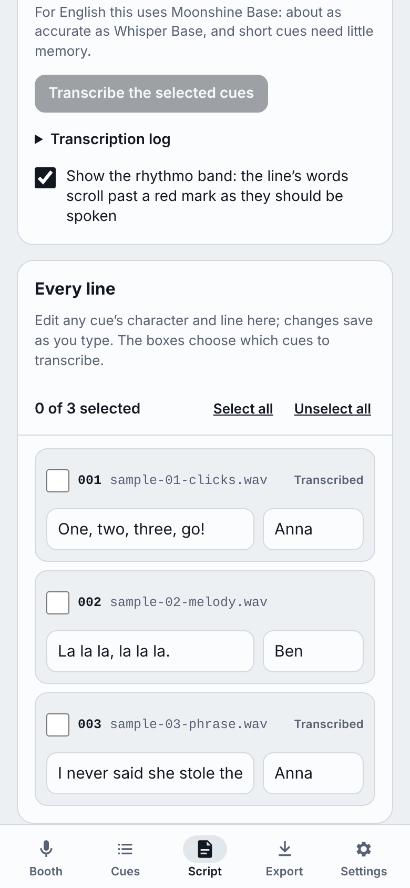
&nbsp;
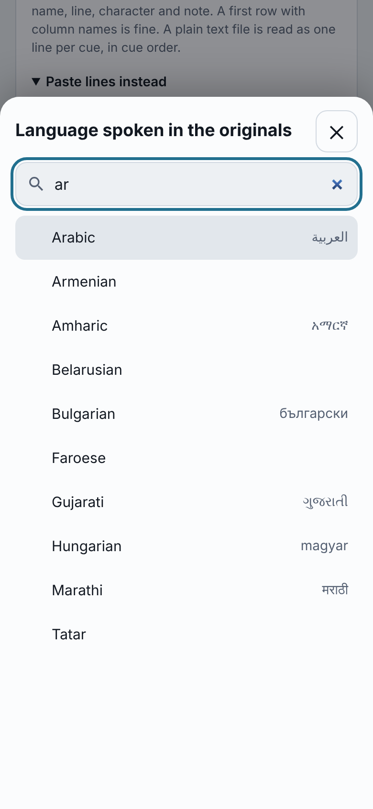

1. **Pick the language** spoken in the originals. The picker searches English names, each language's own name, and codes, ignoring accents (*espanol* finds Spanish). 99 languages are available.
2. **Choose the cues** with the boxes in the line list. **Select all** and **Unselect all** are in the bar above it. To start with, the cues not yet transcribed in that language are selected (kept originals aren't).
3. Tap **Transcribe N selected cues**. Each cue unselects itself when it's done, so after a stop the selection shows what's left. A line you typed or imported is kept; a line from an earlier transcription is replaced. Lines in right-to-left languages read right to left.

**Which model runs:**

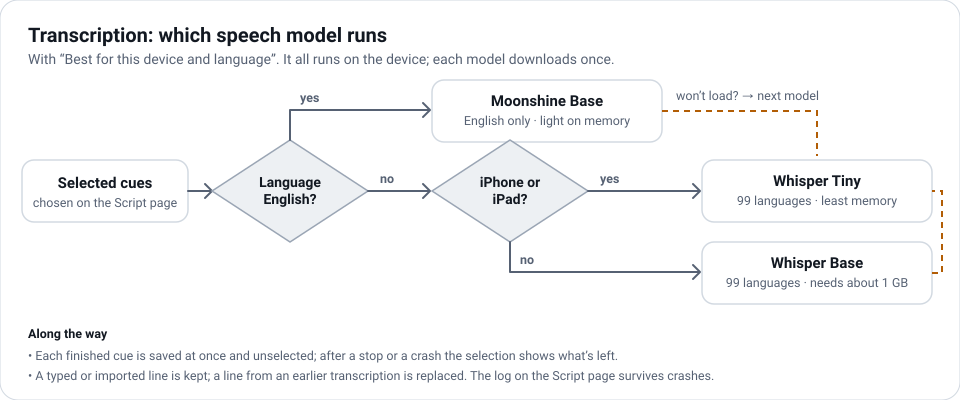

| Speech model | Languages | Notes |
|---|---|---|
| **Best for this device and language** (default) | all | English uses Moonshine Base. Other languages use Whisper Base on a computer and Whisper Tiny on an iPhone or iPad. |
| Whisper Base | 99 | More accurate; needs about 1 GB of memory, more than an iPhone gives a web app. |
| Whisper Tiny | 99 | Least memory; less accurate. |

Whisper always processes 30 seconds of audio, even for a 3-second cue, which is why Whisper Base runs out of memory on a phone. Moonshine (English only) works on the clip's own length, so short cues need little memory, and it's about as accurate as Whisper Base. If a model won't load or runs out of memory, the next one takes over on the same cue.

**If the app closes mid-run** (iOS does this when memory runs out), reopen it: the Script screen says which cue it stopped on, and the **Transcription log** shows each step with the memory used. **Copy the log** to report a problem. Every finished cue is saved as it's done.

## Export

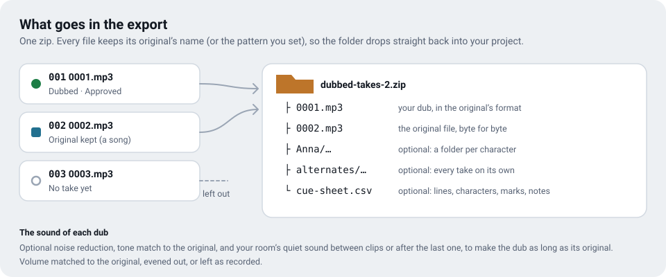


**Sound of your dubs** (applies when you play your dub and when you export):

- **Reduce steady background noise**, like hiss or hum.
- **Match each original's tone** with an automatic EQ.
- **Fill the gaps between clips** with your room's own quiet sound.
- **Make each dub as long as its original:** the time after your last clip is filled with your room's own quiet sound, so each file runs exactly as long as its original and lines up with it end to end. The room sound comes from the quiet moment at the start of your takes, before you speak; if there isn't one, the end is silent. A dub that runs longer than its original is left as it is.
- **Volume:** match each original's loudness, even out (peaks at −1 dB), or leave as recorded.

**Format:** *Same as each original* writes an MP3 with the original's sample rate, channels and bitrate (originals that aren't MP3 use the custom settings). Or choose a custom MP3, or WAV (16-bit, at each original's rate).

**Names and extras:**

- **File names** use a pattern: `{name}` is the original's name, `{cue}` its number, `{character}` who says it. Leave it as `{name}` to keep the same names.
- **Trim silence** from the start and end of each dub. It's off while *Make each dub as long as its original* is on, since trimming would undo it.
- **Character folders:** each character's files in a folder named after them.
- **Alternates:** every take on its own, in an `alternates` folder.
- **Cue sheet:** a CSV with every cue's file names, character, line, marks, notes, length and takes.

Cues marked **Keep the original** go in as the original file, byte for byte. Cues with no take are left out. **Share or save to Files** sends the zip to another app on a phone.

## Backups, storage and working offline

- Takes are saved in the browser as you go. Closing the page or the app loses nothing.
- **Save a backup** (Settings) writes one zip with your originals, every take, your dubs, lines, characters and notes. Open it later with **Load files**, on this device or another.
- **Delete takes that no dub uses** frees space; **Delete all takes** starts over (export first).
- After the first visit the app works offline. When a new version is published, a message offers to reload.


## Remote control and keyboard

Bluetooth keyboards, foot pedals and page turners act like a keyboard. In Settings you can choose a key for each action: record or stop, play my dub, play the original, next cue, previous cue. With **Use headphone and media buttons**, play/pause records or stops, and next and previous change cue.

| Key | Action |
|---|---|
| Space or R | Record or stop |
| O | Play the original |
| T | Play your dub |
| P | Play the selected take |
| B | Both at once |
| A | Back to back |
| ← → | Previous or next cue |
| [ ] | Nudge the selected clip by 10 ms (`{` `}` by 1 ms) |
| L | Line up |
| S | Split the clip |
| Delete | Delete the selected clip |
| + − | Zoom in or out (0 shows the whole cue) |
| Esc | Stop, or clear the selection |
| ⌘Z or Ctrl+Z | Undo (⇧⌘Z or Ctrl+Y redoes) |

## Troubleshooting

- **The microphone doesn't start.** The page has to be opened from an `https://` address. On an iPhone, allow the microphone when asked. If you said no, allow it again in the iPhone's Settings, under Safari → Microphone.
- **The dub is out of sync.** Run **Measure this device** in Settings with headphones on, or nudge and **Line up** clips.
- **Transcription stops or the app closes.** Choose *Best for this device and language* or Whisper Tiny, then carry on: finished cues are kept. Copy the **Transcription log** if you need to report it.
- **Echo of the original in your takes.** Use wired headphones. Echo cancellation is a fallback for when you can't.
- **Which version is running?** The bottom of Settings shows the version.

## For developers

The whole app is one file, [`dub-booth.html`](dub-booth.html), with [`sw.js`](sw.js) for offline use and [`manifest.webmanifest`](manifest.webmanifest) for installing. There's no build step: serve the folder over HTTP (any static server) and open `dub-booth.html`. The microphone needs `https://` or `localhost`.

| File | What it is |
|---|---|
| `dub-booth.html` | The app: markup, styles and script |
| `sw.js` | Offline support: serves the saved copy, checks for a newer one |
| `manifest.webmanifest`, `icon-*.png` | Home Screen install |
| `docs/images/*.svg` | The diagrams in this README |
| `docs/images/*.png` | Screenshots, made by `docs/screenshots.js` |
| `docs/screenshots.js` | Takes the screenshots from the real app |
| `CONTRIBUTING.md` | How changes are made, including keeping this README current |

Speech recognition uses [Transformers.js](https://github.com/huggingface/transformers.js) 3.8.1 from jsDelivr, in a worker, with models from Hugging Face. MP3 encoding uses lamejs and zips use JSZip.

### Keeping this README current

This README describes what the app does today, and it has to stay that way. **Every change to the app updates the README in the same pull request:** new or changed features, renamed buttons, new settings, and the screenshots when a screen changes. See [CONTRIBUTING.md](CONTRIBUTING.md). A check on every pull request flags app changes that come without a README change.

To refresh the screenshots:

```sh
npm install --no-save playwright
npx playwright install chromium
node docs/screenshots.js
```
